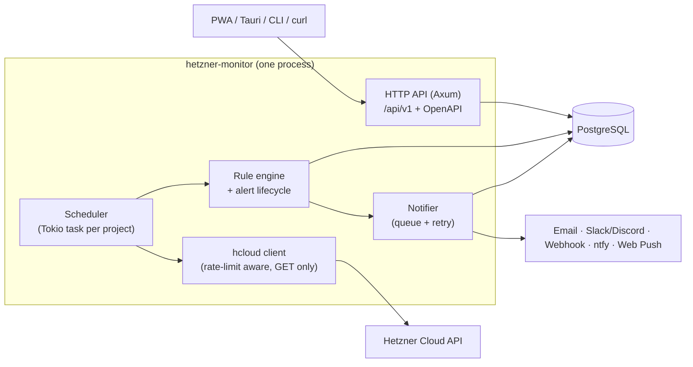

# Architecture

This document is the map of the codebase: what the parts are, how they talk, and which
invariants must hold. Details live in [docs/design/](docs/README.md#design); the reasons live in
[docs/adr/](docs/adr/README.md).

> Status: **M4** — API keys, encrypted tokens, `hcloud` client, scheduler (fast, inventory and metrics tiers, budget,
> leases), rule engine, alert lifecycle, metric checks (M3a) and inventory, hygiene and cost checks with the traffic
> forecast (M3b) are done; notifications (M4): channels email, Slack, Discord, webhook, ntfy, the durable queue and
> notifier, silences and ack are done. Not yet: login/sessions (M5), PWA and Web Push (M6).
> Everything else below is the target design.

## Bird's-eye view

hetzner-monitor polls the **Hetzner Cloud API** with a user's read-only token, evaluates rules
against inventory snapshots and metric time series, manages alert state, and sends notifications.



One binary, three modes via `HM_MODE`: `all` (default, self-hosted), `api`, `worker` (SaaS scale-out).

## Data flow of one poll cycle

1. The **scheduler** picks a project (row lock with `FOR UPDATE SKIP LOCKED`, so multiple workers never poll the same project).
2. It decrypts the project's token in memory, asks the **hcloud client** for the tier that is due
   (fast / metrics / inventory — see [scheduler](docs/design/scheduler.md)).
3. The client records `RateLimit-*` headers; the scheduler recomputes the project's metrics interval.
4. Results update `resources` (inventory snapshot + diff).
5. The **rule engine** evaluates every enabled rule in scope → values → state transitions on `alerts`
   (`pending → firing → resolved`), writing `alert_events`.
6. Each notifiable event enqueues `notification_jobs`; the **notifier** sends them with retry/backoff.

## Code map

Packages carry an `hm-` prefix (a package named `core` would shadow Rust's built-in `core` crate);
directories don't.

```
crates/
  hcloud/   [hm-hcloud] Hetzner Cloud API client. GET only. Pagination via meta.pagination, typed errors,
            rate-limit header capture, metric value parsing (strings → f64). No DB, no domain logic.
  core/     [hm-core] Domain: check implementations, rule evaluation, alert state machine, label selectors,
            secret envelope encryption, budget maths. Pure where possible → unit-testable without IO.
  notify/   [hm-notify] Channel adapters (email, slack, discord, webhook, ntfy; web push with M6) behind one `Notifier`.
  server/   [hm-server → bin `hetzner-monitor`] The binary: Axum API, auth (sessions + API keys), scheduler loop, notifier worker,
            sqlx repositories, CLI subcommands (e.g. `keys rotate`), config loading.
migrations/ sqlx SQL migrations (source of truth for the schema).
web/        React PWA (from M6).
deploy/     docker-compose.yml (app + postgres) and deployment examples.
docs/       Product, design, ADRs, research, plans.
```

Dependency direction: `hm-server → hm-core, hm-notify, hm-hcloud`; `hm-core → hm-hcloud` (types only);
`hm-notify` and `hm-hcloud` depend on nothing internal. **No crate may depend on `hm-server`.**

Already in place: `hm_core::secret::Secret<T>` — the redaction wrapper every secret must use.

## Invariants

These must always hold. Breaking one needs an ADR.

1. **Read-only towards Hetzner.** The `hcloud` crate implements only `GET`.
2. **All Hetzner traffic is budgeted.** Every request is accounted against the project's rate-limit budget (default 50 % of `RateLimit-Limit`).
3. **No plaintext secrets at rest.** Tokens and channel configs are envelope-encrypted with AES-256-GCM; AAD binds ciphertext to its row.
4. **Secrets never leave the process** via logs, errors, API responses or metrics.
5. **Tenant isolation.** Every tenant row hangs off an `organizations` row; every query is scoped by `org_id`.
6. **Data-source failure ≠ resource failure.** If a project's API access is degraded, availability checks for its resources are suspended and one system alert is raised instead.
7. **At most one open alert per (rule, resource)**, enforced by a partial unique index.
8. **No own metric time-series storage.** Metric windows are fetched from Hetzner (30-day retention) when rules are evaluated.
   Derived daily readings Hetzner does not keep (cost estimate, traffic counter) are allowed: one row per day, bounded retention ([ADR-0011](docs/adr/0011-derived-daily-snapshots.md)).
9. **Notifications are durable.** They are queued in Postgres before sending; a restart loses nothing.

## Cross-cutting concerns

- **Config:** `HM_*` env vars only → [configuration](docs/design/configuration.md).
- **Security:** [security](docs/design/security.md) (encryption, auth, SSRF, redaction).
- **Observability:** `tracing` with structured fields; `/healthz`, `/readyz`, `/metrics` (own operational metrics).
- **Testing:** unit tests in `core` (pure logic), `wiremock`-replayed anonymised Hetzner fixtures for `hcloud`, integration tests against a real Postgres.
