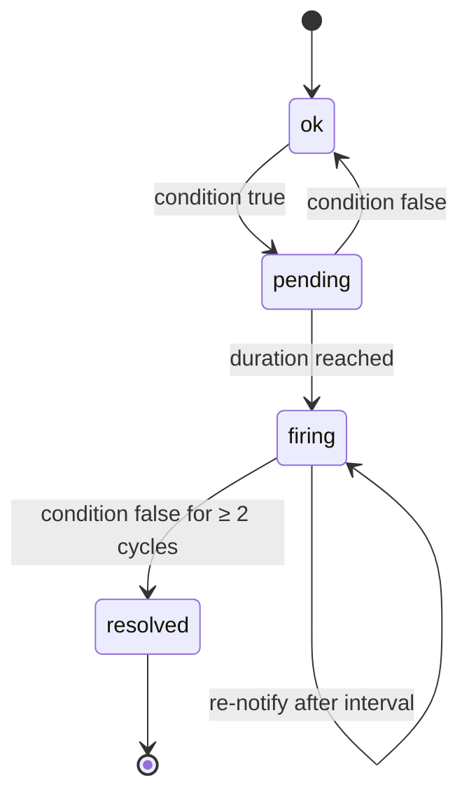

# Design: Rules, alert lifecycle, notifications

Status: rules, state machine, data-source failure **implemented** (M2); notifications, ack, silences, re-notify **proposed** (M4) · Crates: `crates/core` (state machine, selectors), `crates/server` (`engine`), `crates/notify` (channels)

## Rules

Rule = `check_type` + `params` (threshold, duration) + **scope** + severity + optional channels.

- Scope: whole project (or all projects of the org), a single resource, or a **Hetzner label selector** (e.g. `env=prod,role!=db`) — reuse Hetzner's selector syntax so users learn nothing new.
  Supported: `k=v`, `k==v`, `k!=v`, `k`, `!k`, `k in (a,b)`, `k notin (a,b)`; as in Kubernetes, `!=` and `notin` also match resources without the key.
- On project connect, **default rules** are created (`is_default = true`, see [checks](checks.md)) by the SQL function
  `hm_create_default_rules` (migration 0003, the single source of the defaults). Users can edit or disable them via
  `PATCH /rules/{id}`; creating and deleting custom rules comes later.
- Disabling a rule closes its open alerts (firing → resolved, pending → dropped).

## Alert state machine — one per (rule, resource)

- The rule's hold time (`for_s`, per check — see [checks](checks.md)) decides `pending → firing`; with `for_s = 0` an alert opens directly as `firing`.
  Metric checks measure the duration on Hetzner's series instead of the alert's local pending time, so an alert can open directly as `firing` when the series already covers `for_s`.
- `pending → ok` drops the alert row: it never fired, so there is nothing to notify or keep.
- A resource that disappears or leaves the rule's scope closes its alert at once (firing → resolved, pending → dropped).
- Inventory-only rules ([checks](checks.md#inventory-checks-m3b)) are evaluated on inventory cycles only; fast cycles leave their alerts as they are.
- `info` hygiene alerts stay open while the finding holds. Proposal for M4: no re-notify for `info`.
- `resource_lifecycle` is an event, not a condition: it is stored as an alert that fires and resolves in the same cycle
  (events `fired` + `resolved`), so notifications (M4) treat it like any other alert. The first sync of a project reports nothing.
- **Notify** on `firing` and `resolved` only (not `pending`).
- **Dedup:** at most one open alert per (rule, resource) — partial unique index.
- **Flapping guard:** resolve only after 2 consecutive good cycles.
- **Re-notify:** a still-firing alert notifies again every `renotify_s` (default 4 h) unless acknowledged.
- **Acknowledge:** stops re-notify; `resolved` is still sent.
- **Silences:** time window + scope (project, resource, selector). Evaluation continues; notifications are suppressed and recorded as suppressed.

## Data-source failure (invariant 6)

If a project is `degraded` or `invalid_token`, availability checks for its resources are **suspended**
and one **system alert** ("Hetzner API unreachable for project X" / "token invalid") is raised.
A Hetzner outage must never arrive as "all servers down".

Implementation: a failed cycle brings no data, so the engine evaluates only the per-project `hetzner_api` rule
(condition: project status ≠ `active`, no hold time); every other alert keeps its state. The system alert resolves
after two successful cycles, like any other alert.

## Notifications

| Channel | Mechanism | Secret config (encrypted) |
|---|---|---|
| Email | SMTP (`lettre`); server settings instance-wide via `HM_SMTP_*` | recipients |
| Slack | Incoming webhook | webhook URL |
| Discord | Webhook | webhook URL |
| Webhook | JSON `POST`, header `X-HM-Signature: sha256=<HMAC of body>` | URL + signing secret |
| ntfy | HTTP `POST` to topic | server URL, topic, optional token |
| Web Push | VAPID (`web-push`) for the PWA | per-device subscription |

- Routing: each channel has `min_severity`; a rule may pin specific channels.
- One internal payload schema, rendered per channel. The webhook schema is **versioned** (`"version": 1`) and documented.
- Durable queue in `notification_jobs` with exponential backoff; restart-safe (invariant 9).
- Native push (APNs/FCM) arrives with the Tauri mobile app.
