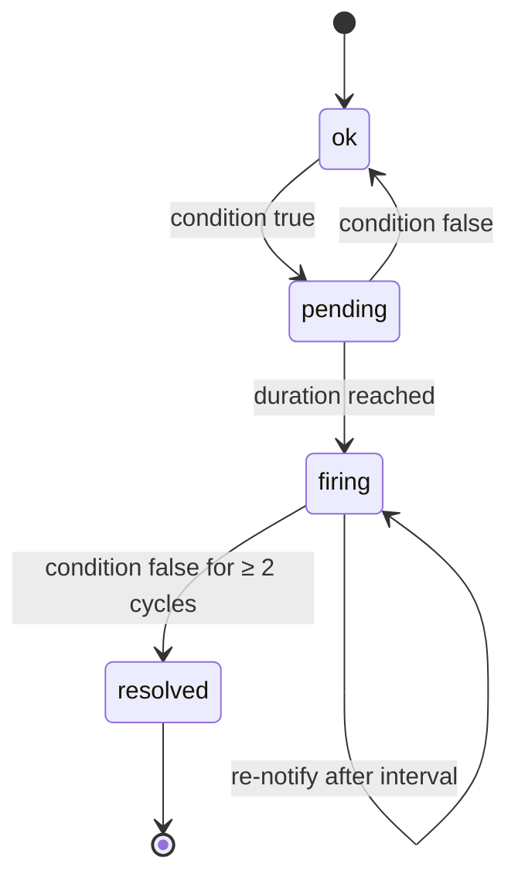

# Design: Rules, alert lifecycle, notifications

Status: rules, state machine, data-source failure **implemented** (M2); notifications, ack, silences, re-notify **implemented** (M4, [ADR-0012](../adr/0012-notification-delivery.md)) · Crates: `crates/core` (state machine, selectors), `crates/server` (`engine`), `crates/notify` (channels)

## Rules

Rule = `check_type` + `params` (threshold, duration) + **scope** + severity + optional channels.

- Scope: whole project (or all projects of the org), a single resource, or a **Hetzner label selector** (e.g. `env=prod,role!=db`) — reuse Hetzner's selector syntax so users learn nothing new.
  Supported: `k=v`, `k==v`, `k!=v`, `k`, `!k`, `k in (a,b)`, `k notin (a,b)`; as in Kubernetes, `!=` and `notin` also match resources without the key.
- On project connect, **default rules** are created (`is_default = true`, see [checks](checks.md)) by the SQL function
  `hm_create_default_rules` (migration 0003, the single source of the defaults). Users can edit or disable them via
  `PATCH /rules/{id}`; creating and deleting custom rules comes later.
- Disabling a rule closes its open alerts (firing → resolved, pending → dropped).

## Alert state machine — one per (rule, resource)



- The rule's hold time (`for_s`, per check — see [checks](checks.md)) decides `pending → firing`; with `for_s = 0` an alert opens directly as `firing`.
  Metric checks measure the duration on Hetzner's series instead of the alert's local pending time, so an alert can open directly as `firing` when the series already covers `for_s`.
- `pending → ok` drops the alert row: it never fired, so there is nothing to notify or keep.
- A resource that disappears or leaves the rule's scope closes its alert at once (firing → resolved, pending → dropped).
- Inventory-only rules ([checks](checks.md#inventory-checks-m3b)) are evaluated on inventory cycles only; fast cycles leave their alerts as they are.
- `info` hygiene alerts stay open while the finding holds; `info` alerts never re-notify.
- `resource_lifecycle` is an event, not a condition: it is stored as an alert that fires and resolves in the same cycle
  (events `fired` + `resolved`), so notifications (M4) treat it like any other alert. The first sync of a project reports nothing.
- **Notify** on `firing` and `resolved` only (not `pending`).
- **Dedup:** at most one open alert per (rule, resource) — partial unique index.
- **Flapping guard:** resolve only after 2 consecutive good cycles.
- **Re-notify:** a still-firing `warning`/`critical` alert notifies again every `renotify_s` (rule column, default 4 h)
  since its last notification, unless acknowledged; not during the flapping guard's good cycles. Event `renotified`.
- **Acknowledge** (`POST /alerts/{id}/ack`): stops re-notify; `resolved` is still sent. Event `acked`.
- **Silences:** time window + scope (project, resource, rule, label selector; none = the whole org). Evaluation continues;
  a covered notification is not queued and an event `suppressed` (with `silence_id`) is recorded. A silence ending later
  recalls nothing and sends nothing retroactively.

## Data-source failure (invariant 6)

If a project is `degraded` or `invalid_token`, availability checks for its resources are **suspended**
and one **system alert** ("Hetzner API unreachable for project X" / "token invalid") is raised.
A Hetzner outage must never arrive as "all servers down".

Implementation: a failed cycle brings no data, so the engine evaluates only the per-project `hetzner_api` rule
(condition: project status ≠ `active`, no hold time); every other alert keeps its state. The system alert resolves
after two successful cycles, like any other alert.

## Notifications

| Channel | Mechanism | Secret config (encrypted) |
|---|---|---|
| Email | SMTP (`lettre`); server settings instance-wide via `HM_SMTP_*` | recipients |
| Slack | Incoming webhook | webhook URL |
| Discord | Webhook | webhook URL |
| Webhook | JSON `POST`, header `X-HM-Signature: sha256=<HMAC of body>` | URL + signing secret |
| ntfy | HTTP `POST` to topic | server URL, topic, optional token |
| Web Push | VAPID (`web-push`) for the PWA | per-device subscription |

Web Push is planned with the PWA (M6); the other five channels are implemented (M4, crate `hm-notify`).

- **Routing** (decided when the event is written): a rule with pinned channels (`rule_channels`) notifies those (if enabled),
  otherwise every enabled channel of the org whose `min_severity` (default `warning`) the alert reaches. `resolved` goes
  only to the channels its `fired`/`renotified` went to. One-shot alerts (`resource_lifecycle`) notify once (`fired`).
- **Queue** (ADR-0012): `fired`, `resolved` and `renotified` insert `notification_jobs` in the alert's transaction. The
  notifier (modes `all`/`worker`, every 2 s) claims due jobs with `FOR UPDATE SKIP LOCKED` and sends while holding the
  lock (10 s timeout). Failures re-queue with backoff 30 s · 2ⁿ⁻¹ (max 1 h; a `429` `Retry-After` is used instead) up to
  8 attempts; 4xx and other permanent errors fail at once. Delivery is **at-least-once**. Finished jobs are kept 90 days.
- **Messages:** title `FIRING|RESOLVED|STILL FIRING [severity] <rule>: <resource>`, body = alert message, project and a
  link (`HM_BASE_URL/alerts/{id}`, the alert in the web UI, when set). Slack: `{text}` (mrkdwn, escaped). Discord: `{content}` ≤ 2000 chars,
  mentions disabled. ntfy: JSON publish to the server root with `topic`, `title`, `message`, `priority` (critical 5,
  warning 4, else 3), `tags`, `click`; optional `Authorization: Bearer`. Email: plain text via SMTP.
- **Native push** (APNs/FCM) arrives with the Tauri mobile app.

### Webhook payload (version 1)

`POST` with `Content-Type: application/json` and headers `X-HM-Event` (`fired|resolved|renotified|test`),
`X-HM-Delivery` (job id; the same on retries — deduplicate on it) and `X-HM-Signature: sha256=<hex HMAC-SHA256 of the
raw body, keyed with the channel secret>`. Verify the signature over the exact bytes received.

```json
{
  "version": 1,
  "event": "fired",
  "at": "2026-11-12T12:00:00Z",
  "alert": { "id": "uuid", "state": "firing", "severity": "critical", "check_type": "server_status",
             "message": "server web-1 (1) is off", "value": null,
             "fired_at": "2026-11-12T12:00:00Z", "resolved_at": null },
  "rule": { "id": "uuid", "name": "Server not running" },
  "project": { "id": "uuid", "name": "prod" },
  "resource": { "kind": "server", "hetzner_id": 1, "name": "web-1" },
  "link": "https://hm.example.com/alerts/uuid"
}
```

`resource` is `null` for project-level alerts (`hetzner_api`) and `link` is `null` without `HM_BASE_URL`. New fields may
be added within version 1; removing or changing one bumps the version.
