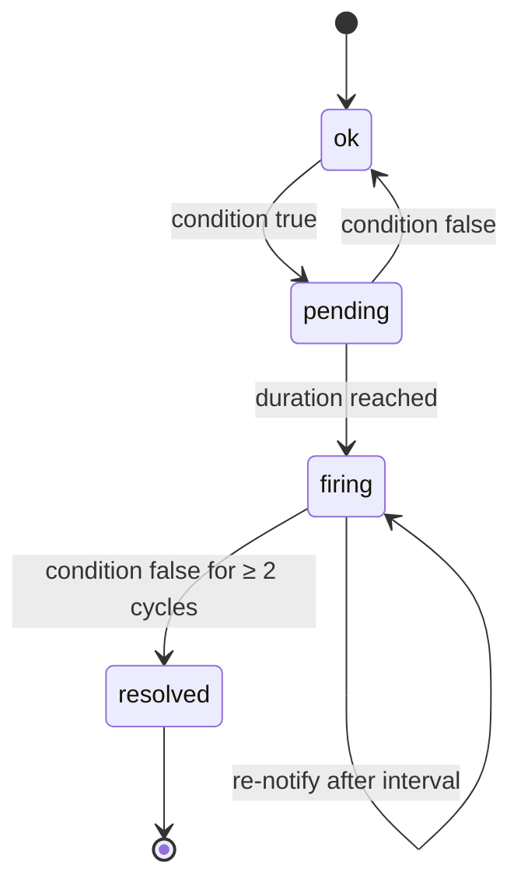

# Design: Rules, alert lifecycle, notifications

Status: **proposed** · Crates: `crates/core` (state machine), `crates/notify` (channels), `crates/server` (queue worker)

## Rules

Rule = `check_type` + `params` (threshold, duration) + **scope** + severity + optional channels.

- Scope: whole project (or all projects of the org), a single resource, or a **Hetzner label selector** (e.g. `env=prod,role!=db`) — reuse Hetzner's selector syntax so users learn nothing new.
- On project connect, **default rules** are created (`is_default = true`, see [checks](checks.md)). Users can edit or disable them.

## Alert state machine — one per (rule, resource)

- **Notify** on `firing` and `resolved` only (not `pending`).
- **Dedup:** at most one open alert per (rule, resource) — partial unique index.
- **Flapping guard:** resolve only after 2 consecutive good cycles.
- **Re-notify:** a still-firing alert notifies again every `renotify_s` (default 4 h) unless acknowledged.
- **Acknowledge:** stops re-notify; `resolved` is still sent.
- **Silences:** time window + scope (project, resource, selector). Evaluation continues; notifications are suppressed and recorded as suppressed.

## Data-source failure (invariant 6)

If a project is `degraded` or `invalid_token`, availability checks for its resources are **suspended**
and one **system alert** ("Hetzner API unreachable for project X" / "token invalid") is raised.
A Hetzner outage must never arrive as "all servers down".

## Notifications

| Channel | Mechanism | Secret config (encrypted) |
|---|---|---|
| Email | SMTP (`lettre`); server settings instance-wide via `HM_SMTP_*` | recipients |
| Slack | Incoming webhook | webhook URL |
| Discord | Webhook | webhook URL |
| Webhook | JSON `POST`, header `X-HM-Signature: sha256=<HMAC of body>` | URL + signing secret |
| ntfy | HTTP `POST` to topic | server URL, topic, optional token |
| Web Push | VAPID (`web-push`) for the PWA | per-device subscription |

- Routing: each channel has `min_severity`; a rule may pin specific channels.
- One internal payload schema, rendered per channel. The webhook schema is **versioned** (`"version": 1`) and documented.
- Durable queue in `notification_jobs` with exponential backoff; restart-safe (invariant 9).
- Native push (APNs/FCM) arrives with the Tauri mobile app.
